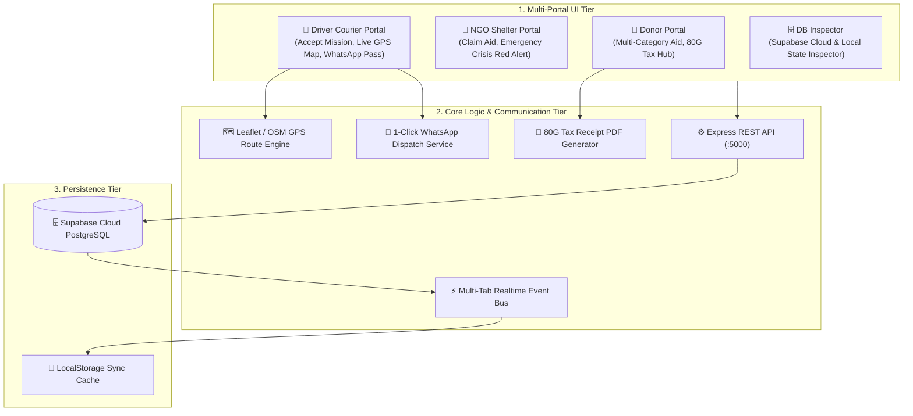

# 🍲 Surplus-To-Shelter: Unified Multi-Category Aid & Logistics Platform

> **Connecting Donors, Verified NGO Shelters, and Courier Drivers with Multi-Category Aid Matching (Food, Clothes, Blankets, Books, Medicines), Live Animated GPS Route Telemetry, 1-Click WhatsApp Dispatch Alerts, & Section 80G Tax Certificates.**


---

## 📊 Executive Summary & Project Pitch

**Surplus-To-Shelter** is an end-to-end humanitarian rescue and logistics ecosystem that automates the collection and distribution of surplus food, winter clothing, blankets, educational books, medical first-aid kits, and hygiene supplies from commercial donors and individuals to verified NGO shelters and community centers.

By integrating **multi-category aid routing**, **100% free OpenStreetMap live animated GPS tracking**, **1-click WhatsApp dispatch alerts with handover PINs**, **IoT thermal cold-chain telemetry**, **NGO emergency crisis dispatch**, and automated **Section 80G Tax Deduction Certificate generation**, Surplus-To-Shelter eliminates waste, simplifies logistics, and accelerates relief delivery.

---

## 🌟 Detailed Platform Portals & Features

### 1. 🏪 Donor & Restaurant Portal
- **Multi-Category Donation Posting (`restaurant-post.html`)**: Clean, intuitive form supporting:
  - 🍲 **Fresh Cooked Meals & Food Rations**: Weight (kg), meal servings, cooking time, and dietary type.
  - 🧥 **Clothes & Footwear**: Clean winter coats, sweaters, and footwear sorted by condition.
  - 🛏️ **Thermal Blankets & Bedding**: Quilted blankets and sleeping mats.
  - 📚 **Books & Stationery**: School textbooks, storybooks, and educational supplies.
  - 🩹 **Medicines & First Aid**: OTC medicines with safety expiry and batch verification.
  - 🧼 **Hygiene Packs**: Soaps, sanitizers, dental kits, and sanitary products.
  - 💳 **Monetary Contributions**: Direct verified shelter funding with escrow sandbox.
- **Smart Recipient Matching (`restaurant-matching.html`)**: Evaluates nearby verified NGOs by distance, live capacity, and immediate necessity ranking.
- **🗺️ Live Animated GPS Route Radar**: Real-time Leaflet route map showing delivery courier van advancing along city coordinates with live ETA countdown and target shelter switching.
- **Donation History (`restaurant-history.html`)**: Complete verified relief ledger with category filters, delivery timeline, 80G tax receipt downloads, and clean zero-state isolation for new donor accounts.
- **Active Pickup Tracker (`restaurant-pickups.html`)**: Real-time monitoring of assigned courier drivers, live vehicle telemetry, and 1-click WhatsApp dispatch passes.
- **ESG Impact & 80G Tax Hub (`restaurant-impact.html`)**: Real-time calculation of tax deductions earned, CO₂ reduced, landfill diversion, and 1-click printable PDF 80G tax certificates.

### 2. 🤝 NGO & Shelter Portal
- **Live Aid Feed (`ngo-dashboard.html`)**: Real-time feed of available surplus food batches and essential items within city radius.
- **1-Click Aid Claiming**: Locks item batches, generates unique **Handover PIN** (e.g., `4829`), and auto-assigns driver dispatch.
- **Emergency Crisis Broadcast**: Trigger "Red Alert Emergency Requests" (Severe Weather, Cold Wave, Flood Relief) to broadcast immediate aid requests across the network.
- **Intake Log & Safety Verification**: Record receiving condition, thermal readings, and verify dispatch PIN upon courier arrival.

### 3. 🚚 Driver Courier Portal
- **Open Pickup Market (`driver-available.html`)**: Browse pending rescue missions with estimated pay, distance, cargo specifications, and urgency.
- **Active Mission Execution (`driver-active.html`)**: Turn-by-turn navigation monitor, live animated vehicle GPS tracking, site contact calling, and 1-click WhatsApp dispatch passes.
- **Interactive Route Guidance (`driver-route.html`)**: Live Leaflet navigation map with dynamic ETA recalculation and milestone progress HUD.
- **Earnings & Impact Hub (`driver-impact.html`, `driver-history.html`)**: Track total mission earnings, base pay, distance allowances, emergency surge bonuses, and eco-points.

### 4. 🗄️ Database Inspector & Dev Gateway (`db-viewer.html`)
- Live inspector to monitor Supabase Cloud PostgreSQL database tables (`users`, `donations`, `pickups`).
- One-click cache cleaner, record deletion, and test data seeder for rapid testing.

---

## 🛠️ Specialized Technical Engines

### 🗺️ 1. Live Animated GPS Route Map Engine (`js/maps.js`)
* **100% Free OpenStreetMap & Leaflet Integration**: Operates without Google Maps API keys or commercial billing requirements.
* **Coordinate Interpolation & Vehicle Simulation**:
  * Animates delivery courier van smoothly across real street waypoints (Ashok Marg, Statue Circle, MI Road, JLN Marg, Hope Shelter).
  * Calculates dynamic bearing/heading angle to rotate the van marker realistically in the direction of motion.
  * Draws dual polylines: solid glowing emerald trail for traveled path and dashed trail for remaining distance.
* **Interactive Telemetry HUD**:
  * Live speedometer (oscillates realistically between 32–46 km/h).
  * Dynamic countdown ETA (`8 min ➔ 6 min ➔ 4 min ➔ Arrived!`).
  * Current corridor name and maneuver instructions.
  * Play/pause controls, speed multipliers (`1x`, `2x`, `4x`), and camera recenter toggle.

### 📲 2. 1-Click WhatsApp & SMS Dispatch Alerts (`js/whatsapp-alerts.js`)
* **Zero-Cost Deep-Linking (`https://wa.me/?text=...`)**:
  * Formats role-tailored dispatch markdown messages for native mobile WhatsApp and desktop WhatsApp Web.
  * Role templates for **Courier Driver**, **NGO Shelter Intake Officer**, and **Donor**.
  * Embeds item specifications, donor site, arrival ETA, live route link, and **Handover PIN** (`4829`).
* **Interactive WhatsApp Modal**: Dark WhatsApp preview bubble, role switcher tabs, and clipboard copy.
* **Backend Webhook Endpoint**: `POST /api/notifications/whatsapp` in `server/index.js` for automated dispatch acknowledgments.

### 📄 3. Section 80G Tax Certificate PDF Generator (`js/pdf-generator.js`)
* Computes Fair Market Value based on category valuation standards.
* Calculates 50% Section 80G Tax Deduction under Indian Income Tax Act, 1961.
* Generates official, print-ready digital certificates with SHA256 verification hash and certified non-profit trust seal.

### 🚨 4. Emergency Relief Red Alert System (`js/motion.js`)
* Cross-tab storage event bus synchronizes crisis alerts across all active browser sessions without page reloads.
* Renders emergency red alert banners across donor and driver screens with 1-click response triggers.

---

## 📖 Comprehensive Step-by-Step Usage Guide

### Scenario A: How a Donor Posts Multi-Category Aid & Claims 80G Tax Credit
1. Open the platform at `http://localhost:3000` and select **Donor Portal**.
2. Go to **Post Donation** (`restaurant-post.html`).
3. Select your category pill (Food, Clothes, Blankets, Books, Medicines, Hygiene, or Funds).
4. Fill in the item specifications:
   - Item Title & Specific Category
   - Quantity & Unit (e.g., *50 blankets*, *40 jackets*, or *35 kg cooked meals*)
   - Packaging condition & special handling instructions
5. Click **Post Donation**.
6. Navigate to **Recipient Matching** (`restaurant-matching.html`) to view the **Live Animated GPS Route Radar**, preview courier velocity, and select an NGO.
7. Click **Confirm Dispatch**. Courier is assigned and a 1-click WhatsApp Dispatch Pass with Handover PIN (`4829`) is generated.
8. After delivery, visit **ESG Impact** (`restaurant-impact.html`) and click **Generate 80G Tax Certificate** to download your printable tax receipt (`js/pdf-generator.js`).

### Scenario B: How an NGO Claims Aid & Triggers Emergency Relief
1. Open **NGO / Shelter Portal** (`ngo-dashboard.html`).
2. Review the **Live Aid Feed** for incoming food, blankets, clothes, or relief supplies.
3. Click **Claim Aid Batch** to lock the batch for your shelter.
4. **During a Crisis / Emergency**: Click **Trigger Emergency Red Alert** at the top of the dashboard.
5. Select crisis type (e.g., *Cold Wave Emergency*, *Flood Relief*) and required items.
6. This immediately broadcasts a Red Alert banner across all donor and driver screens.

### Scenario C: How a Courier Driver Accepts & Navigates a Mission
1. Open **Driver Courier Portal** (`driver-dashboard.html`).
2. Go to **Available Pickups** (`driver-available.html`) to review pending rescue missions.
3. Click **Accept Mission**.
4. Switch to **Active Pickup** (`driver-active.html`) to view the interactive GPS route map with delivery van simulation, live ETA countdown, and thermal temperature monitoring (`4.2°C`).
5. Click **📲 1-Click WhatsApp Dispatch Pass** to send the handover pass and PIN directly to the donor and shelter.
6. Upon arrival at the shelter, verify the Handover PIN and click **Confirm Delivery**. Payout and Eco-Points will credit immediately.

---

## 🏗️ System Architecture & Data Flow



---

## 📁 Repository Directory Structure

```text
donate/
├── index.html                     # Central Portal Switcher & Auth Gateway
├── restaurant-dashboard.html      # Donor Main Dashboard & Quick Stats
├── restaurant-post.html           # Multi-Category Donation Posting Form
├── restaurant-matching.html       # Smart Recipient Matching & Live GPS Radar
├── restaurant-donations.html      # Active Donation Manifest Feed
├── restaurant-history.html        # Donor Past Donation History & 80G Receipts
├── restaurant-pickups.html        # Live Driver Dispatch & WhatsApp Pass Hub
├── restaurant-notifications.html  # Alerts & Emergency Crisis Feed
├── restaurant-impact.html         # ESG Impact Dashboard & 80G Tax Certificates
├── restaurant-settings.html       # Donor Profile & Pickup Preferences
├── ngo-dashboard.html             # NGO Shelter Claiming & Intake Dashboard
├── driver-dashboard.html          # Driver Active Mission & Earnings Overview
├── driver-available.html          # Driver Open Pickup Market
├── driver-active.html             # Live Navigation, Animated GPS Van & IoT Telemetry
├── driver-route.html              # Turn-by-Turn Mission Route Guidance
├── driver-history.html            # Driver Delivery History & Payout Log
├── driver-impact.html             # Driver Eco-Points & Community Impact Badges
├── driver-notifications.html      # Real-Time Pickups & Emergency Alerts Feed
├── driver-settings.html           # Driver Profile, Vehicle Info & Pay Preferences
├── db-viewer.html                 # Supabase & Local Database Inspector
├── css/
│   └── animations.css             # Universal Button Motion, Radar Pulse & Transitions
├── js/
│   ├── app.js                     # Unified Multi-Portal Navigation & State Controller
│   ├── maps.js                    # Leaflet + OpenStreetMap Live Animated Route Map Engine
│   ├── search.js                  # Universal Smart Search & Verified NGO Autocomplete Engine
│   ├── whatsapp-alerts.js         # 1-Click WhatsApp & SMS Dispatch Alerts Module
│   ├── motion.js                  # Global Interactivity & Emergency Crisis Sync
│   ├── pdf-generator.js           # 80G Tax Deduction Certificate PDF Generator
│   ├── supabase.js                # Supabase SDK Client & Local Bridge
│   ├── tutorial.js                # Interactive Platform Walkthrough & Guidance
│   └── new-user-cleaner.js        # State Sanitizer for New Test Sessions
├── server/
│   └── index.js                   # Express REST API Backend (:5000)
└── supabase/
    └── schema.sql                 # PostgreSQL Database Schema
```

---

## 🗄️ Database Schema Summary (`supabase/schema.sql`)

- **`users`**: User profiles (`id`, `name`, `email`, `role`, `phone`, `address`).
- **`donations`**: Aid records (`id`, `title`, `category`, `quantity_kg`, `portions`, `condition`, `donor_id`, `recipient_id`, `status`).
- **`pickups`**: Delivery dispatch records (`id`, `donation_id`, `driver_id`, `status`, `temp_celsius`, `seal_verified`, `pickup_time`, `delivery_time`).

---

## ⚡ Local Development & Setup

### Prerequisites
- **Node.js** (v18.0 or higher)
- **npm** (v9.0 or higher)

### Step 1: Clone Repository & Install Dependencies
```bash
git clone https://github.com/sachinjatavat/sts.git
cd sts
npm install
```

### Step 2: Environment Configuration
Create or inspect `.env` in the root directory:
```env
PORT=5000
SUPABASE_URL=https://juhjxcxbrirzfppjghlj.supabase.co
SUPABASE_ANON_KEY=sb_publishable__Q6ZFUUsSS6a28VjJRCL-w_DixWn7_Y
```

### Step 3: Launch Servers
```bash
# Start Vite Frontend Dev Server (Port 3000)
npm run dev

# Start Express Backend Server (Port 5000)
npm run server
```

Open your browser at **`http://localhost:3000`**.

---

## 👥 Project Team & Credits

Developed with ❤️ for community welfare and zero-waste logistics:

- 🌟 **Sachin**
- 🌟 **Krishna**
- 🌟 **Nitesh**
- 🌟 **Priyanshi**

---

## 📜 License

Distributed under the **MIT License**. See `LICENSE` for details.
