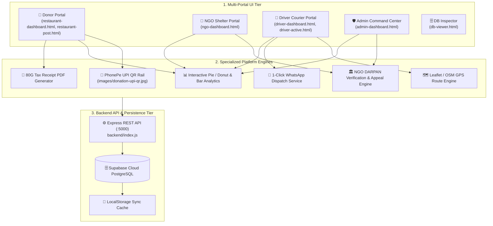

# 🍲 Surplus-To-Shelter: Unified Multi-Category Aid & Logistics Platform

> **Connecting Donors, Verified NGO Shelters, and Courier Drivers with Multi-Category Aid Matching (Food, Clothes, Blankets, Books, Medicines, Funds), Instant PhonePe UPI QR Code Donations, Live Animated GPS Route Telemetry, Interactive Analytics Hubs (Pie/Bar Charts), 1-Click WhatsApp Dispatch Alerts, & Section 80G Tax Certificates.**


---

## 📊 Executive Summary & Project Pitch

**Surplus-To-Shelter** is an end-to-end humanitarian rescue and logistics ecosystem that automates the collection and distribution of surplus food, winter clothing, blankets, educational books, medical first-aid supplies, and monetary relief from commercial donors and individuals to verified NGO shelters and community centers.

By integrating **multi-category aid routing**, **instant PhonePe UPI QR Code donations**, **100% free OpenStreetMap live animated GPS tracking**, **interactive pie & bar chart analytics across all portals**, **government NGO-DARPAN verification & admin appeal workflows**, **1-click WhatsApp dispatch alerts with handover PINs**, **IoT thermal cold-chain telemetry**, and automated **Section 80G Tax Deduction Certificate generation**, Surplus-To-Shelter eliminates waste, simplifies logistics, and accelerates relief delivery.

---

## 🌟 Detailed Platform Portals & Features

### 1. 🏪 Donor & Restaurant Portal
- **Multi-Category Donation Posting (`restaurant-post.html`)**: Clean, intuitive form supporting:
  - 🍲 **Fresh Cooked Meals & Food Rations**: Weight (kg), meal servings, cooking time, and dietary type.
  - 🧥 **Clothes & Footwear**: Clean winter coats, sweaters, and footwear sorted by condition.
  - 🛏️ **Thermal Blankets & Bedding**: Quilted blankets and sleeping mats.
  - 📚 **Books & Stationery**: School textbooks, storybooks, and educational supplies.
  - 🩹 **Medicines & First Aid**: OTC medicines with safety expiry and batch verification.
  - 🧼 **Hygiene Packs**: Soaps, sanitizers, dental kits, and sanitary products.
  - 💳 **Monetary Contributions & Mall-Style POS Fixed-Amount PhonePe UPI QR Terminal**: Donors input custom amounts or click quick denominations, generating a dynamic QR code pre-encoded with the exact fixed amount that routes directly to **Sachin Kumar Jatawat** (`8946955851-2@ybl`).
- **🏬 Mall-Style POS Fixed-Amount PhonePe UPI QR Terminal**:
  - **Locked Pre-Filled Amount**: Works identical to supermarket and shopping mall billing counters (Reliance, DMart, Zara). The exact entered amount (e.g. ₹500, ₹1,000, ₹2,500) is dynamically encoded into the NPCI UPI payload (`am=<amount>&mode=02&purpose=00`), so scanning with **PhonePe**, **Google Pay**, **Paytm**, or **BHIM** pre-fills and locks the exact amount automatically on the donor's screen.
  - **Direct Account Routing**: 100% of the funds route directly to **Sachin Kumar Jatawat** (`8946955851-2@ybl`).
  - **Dynamic Dual-Engine QR Generator**:
    - **Client-Side Engine (`frontend/js/qrcode.min.js`)**: Instant zero-latency offline QR generation as the user types or clicks chips.
    - **REST API Fallback (`GET /api/qr/upi`)**: Server-side endpoint generating high-resolution Base64 PNG data URLs.
  - **Interactive POS Modal & Mobile 1-Tap**:
    - Full-screen high-resolution modal with locked amount counter (`₹2,500.00`) and verified payee verification badge.
    - 1-tap mobile payment deep-link (`upi://pay?...`) for donors on mobile devices.
    - Instant ledger transaction recording and Section 80G Tax Exemption Certificate generation.
- **📊 Interactive Analytics Hub (`restaurant-dashboard.html`)**:
  - Live SVG Donut / Pie Chart & Bar Graph toggle.
  - Visual breakdown across Food Rescue, Warm Clothing, Blankets, Educational Books, Medicines, and Monetary Grants.
- **Smart Recipient Matching (`restaurant-matching.html`)**: Evaluates nearby verified NGOs by distance, live capacity, and immediate necessity ranking.
- **🗺️ Live Animated GPS Route Radar**: Real-time Leaflet route map showing delivery courier van advancing along city coordinates with live ETA countdown and target shelter switching.
- **Donation History & Relief Ledger (`restaurant-history.html`, `restaurant-donations.html`)**: Complete verified relief ledger with category filters, delivery timeline, and direct UPI QR donation shortcuts.
- **Active Pickup Tracker (`restaurant-pickups.html`)**: Real-time monitoring of assigned courier drivers, live vehicle telemetry, and 1-click WhatsApp dispatch passes.
- **ESG Impact & 80G Tax Hub (`restaurant-impact.html`)**: Real-time calculation of tax deductions earned, CO₂ reduced, landfill diversion, and 1-click printable PDF 80G tax certificates.

---

### 2. 🤝 NGO & Shelter Portal (`ngo-dashboard.html`)
- **Government NGO-DARPAN Verification Status**: Real-time badge display showing Darpan ID verification (`KA/2021/0284752`), 80G status, and validity.
- **🚨 Admin Rejection & Instant Appeal Workflow**:
  - If rejected by administrators (e.g., mismatched certificate or expired Darpan registration), a high-visibility rejection alert banner appears on the NGO Dashboard.
  - Displays administrator remarks, rejection reason, and exact timestamp.
  - Includes a 1-click **"Submit Appeal & Re-verify"** action allowing the NGO to update their credentials and request priority re-review.
- **📊 Intake & Capacity Analytics Hub**: Dynamic Pie/Donut and Bar Charts detailing item distributions (Prepared Food vs. Blankets vs. Medicines) and warehouse capacity.
- **Live Aid Feed & 1-Click Claiming**: Real-time feed of available surplus batches. Locks item batches, generates a unique **Handover PIN** (e.g., `4829`), and auto-assigns driver dispatch.
- **Emergency Crisis Red Alert Broadcast**: Trigger urgent alerts for Cold Waves, Floods, or Storms to solicit immediate community supplies.

---

### 3. 🚚 Driver Courier Portal (`driver-dashboard.html`)
- **📊 Fleet Delivery & Performance Hub**: Interactive Pie/Donut and Bar Charts showing mission statuses (Completed, In Transit, Dispatched) and weekly Eco-Points earned.
- **Open Pickup Market (`driver-available.html`)**: Browse pending rescue missions with estimated pay, distance, cargo specifications, and urgency.
- **Active Mission Execution (`driver-active.html`)**: Turn-by-turn navigation monitor, live animated vehicle GPS tracking, site contact calling, and 1-click WhatsApp dispatch passes.
- **Interactive Route Guidance (`driver-route.html`)**: Live Leaflet navigation map with dynamic ETA recalculation and milestone progress HUD.
- **Earnings & Impact Hub (`driver-impact.html`, `driver-history.html`)**: Track total mission earnings, base pay, distance allowances, emergency surge bonuses, and eco-points.

---

### 4. 🛡️ Admin Command Center (`admin-dashboard.html`)
- **🏛️ NGO DARPAN Verification Governance**:
  - Review pending NGO registrations with official Darpan IDs.
  - 1-Click Approve with instant verified badge generation.
  - 1-Click Reject with structured rejection reasons (Invalid ID, Expired 80G, Unverifiable Site, Non-compliant Documentation) that instantly notify the NGO dashboard.
  - Process inbound NGO re-verification appeals with audit timestamps.
- **📊 Platform Telemetry Hub**: Full platform-wide analytics charts tracking total kg rescued, meals provided, active drivers, and relief disbursements.

---

### 5. 🗄️ Database Inspector & Dev Gateway (`db-viewer.html`)
- Live inspector to monitor Supabase Cloud PostgreSQL database tables (`users`, `donations`, `pickups`).
- One-click cache cleaner, record deletion, and test data seeder for rapid testing.

---

## 🛠️ Specialized Technical Engines

### 📱 1. Instant PhonePe UPI QR Code Rail (`images/donation-upi-qr.jpg`)
* **Zero Intermediary Fees**: Routes monetary donations directly to shelter bank accounts without gateway commission cuts.
* **Universal UPI Compatibility**: Scannable using **PhonePe**, **Google Pay**, **Paytm**, **BHIM**, or any mobile banking app.
* **Dynamic Modal Flow**: In `restaurant-post.html`, donors choosing monetary contributions are automatically presented with the high-resolution QR modal, dynamic amount display, and 1-click payment confirmation button.
* **Server Verification Webhook**: Backend API (`backend/index.js`) validates orders and generates immutable receipts.

### 📈 2. Interactive Charts & Pie Analytics Engine
* **Modern Lightweight SVG Data Visualizations**: Rendered across all 4 platform portals with smooth gradients and hover cards.
* **Pie / Donut & Bar Graph Dual Mode**: Single-click toggling between radial distribution and comparative bar breakdowns.
* **Real-time Synchronization**: Dynamically updates as donations are registered, claimed, and delivered.

### 🗺️ 3. Live Animated GPS Route Map Engine (`js/maps.js`)
* **100% Free OpenStreetMap & Leaflet Integration**: Operates without Google Maps API keys or commercial billing requirements.
* **Coordinate Interpolation & Vehicle Simulation**:
  * Animates delivery courier van smoothly across real street waypoints.
  * Calculates dynamic bearing/heading angle to rotate the van marker realistically in the direction of motion.
  * Draws dual polylines: solid glowing emerald trail for traveled path and dashed trail for remaining distance.
* **Interactive Telemetry HUD**: Live speedometer (32–46 km/h), countdown ETA, and camera recenter controls.

### 📲 4. 1-Click WhatsApp & SMS Dispatch Alerts (`js/whatsapp-alerts.js`)
* **Zero-Cost Deep-Linking (`https://wa.me/?text=...`)**:
  * Role templates for **Courier Driver**, **NGO Shelter Intake Officer**, and **Donor**.
  * Embeds item specifications, donor site, arrival ETA, live route link, and **Handover PIN** (`4829`).
* **Interactive WhatsApp Modal**: Dark WhatsApp preview bubble, role switcher tabs, and clipboard copy.

### 📄 5. Section 80G Tax Certificate PDF Generator (`js/pdf-generator.js`)
* Computes Fair Market Value based on category valuation standards.
* Calculates 50% Section 80G Tax Deduction under Indian Income Tax Act, 1961.
* Generates official, print-ready digital certificates with SHA256 verification hash and certified non-profit trust seal.

---

## 📖 Comprehensive Step-by-Step Usage Guide

### Scenario A: How to Pay Monetary Donation via Mall-Style Fixed-Amount PhonePe QR Code
1. Open the platform at `http://localhost:3000` and go to **Donor Portal** (`restaurant-post.html?cat=money`).
2. Click the **Monetary Contribution** category pill.
3. Select your beneficiary shelter (e.g., *Hope Shelter & Care Center*) and specify your desired donation amount (e.g., *₹2,500* or click one of the quick chips: *₹200*, *₹500*, *₹1,000*, *₹2,500*, *₹5,000*, *₹10,000*).
4. Notice the live **PhonePe POS Terminal** update instantly in real time with the **`FIXED ₹[amount]`** badge and verified payee **`✓ SACHIN KUMAR JATAWAT`** (`8946955851-2@ybl`).
5. Click **"⚡ Generate Fixed-Amount QR Code for ₹[amount]"** or **"Enlarge Fixed QR Code"**.
6. The full-screen **PhonePe POS Fixed-Amount Checkout Modal** appears with the high-resolution QR code and locked amount counter (`₹[amount].00`).
7. Open **PhonePe**, **Google Pay**, **Paytm**, or **BHIM** on your mobile device and scan the screen:
   - Just like scanning a supermarket POS bill, your UPI app **locks and pre-fills the exact donation amount** automatically (no typing required).
   - If on mobile, tap the **"📱 Pay via App"** button to jump directly into your banking app with one click.
8. Complete payment to **Sachin Kumar Jatawat**, return to the platform, and click **"✅ I Have Completed Payment"**.
9. The transaction is instantly recorded into the verified Supabase ledger, and a Section 80G Tax Deduction Certificate is issued automatically!

### Scenario B: How an NGO Handles Rejection & Submits an Appeal
1. When an administrator rejects an NGO's verification in `admin-dashboard.html` with a reason (e.g. *Invalid NGO-DARPAN ID*), the NGO's dashboard (`ngo-dashboard.html`) immediately reflects the rejection.
2. A prominent red alert banner informs the shelter: *"Verification Request Rejected by Administrator"*, detailing the reason and date.
3. The NGO clicks **"Submit Appeal & Re-verify"**.
4. An appeal modal opens allowing them to input their updated DARPAN ID and supplementary notes.
5. Upon submission, status shifts to *"Appeal Submitted - Under Administrator Review"*, alerting the Admin Command Center for prompt re-evaluation.

### Scenario C: How a Donor Posts Multi-Category Aid & Claims 80G Tax Credit
1. Open **Post Donation** (`restaurant-post.html`) and select any category (Food, Clothes, Blankets, Books, Medicines).
2. Enter item quantity, condition, and pickup window. Click **Post Donation**.
3. Navigate to **Recipient Matching** (`restaurant-matching.html`) to view the **Live Animated GPS Route Radar** and assign an NGO.
4. Click **Confirm Dispatch** to trigger the courier assignment and 1-click WhatsApp Dispatch Pass with Handover PIN (`4829`).
5. After delivery, visit **ESG Impact** (`restaurant-impact.html`) to download your 80G tax deduction PDF certificate.

---

## 🏗️ System Architecture & Data Flow



---

## 📁 Clean Repository Directory Structure

```text
donate/
├── frontend/                      # 🎨 Complete Client-Side Application Tier
│   ├── index.html                 # Central Portal Switcher & Auth Gateway
│   ├── restaurant-dashboard.html  # Donor Main Dashboard & Analytics Hub (Pie/Bar)
│   ├── restaurant-post.html       # Multi-Category Posting & PhonePe UPI QR Modal
│   ├── restaurant-matching.html   # Smart Recipient Matching & Live GPS Radar
│   ├── restaurant-donations.html  # Active Donation Manifest & UPI Quick Actions
│   ├── restaurant-history.html    # Donor Past Donation History & 80G Receipts
│   ├── restaurant-pickups.html    # Live Driver Dispatch & WhatsApp Pass Hub
│   ├── restaurant-notifications.html # Alerts & Emergency Crisis Feed
│   ├── restaurant-impact.html     # ESG Impact Dashboard & 80G Tax Certificates
│   ├── restaurant-settings.html   # Donor Profile & Pickup Preferences
│   ├── ngo-dashboard.html         # NGO Intake, Darpan Verification & Appeal Hub
│   ├── driver-dashboard.html      # Driver Active Missions & Fleet Analytics (Pie/Bar)
│   ├── driver-available.html      # Driver Open Pickup Market
│   ├── driver-active.html         # Live Navigation, Animated GPS Van & IoT Telemetry
│   ├── driver-route.html          # Turn-by-Turn Mission Route Guidance
│   ├── driver-history.html        # Driver Delivery History & Payout Log
│   ├── driver-impact.html         # Driver Eco-Points & Community Impact Badges
│   ├── driver-notifications.html  # Real-Time Pickups & Emergency Alerts Feed
│   ├── driver-settings.html       # Driver Profile, Vehicle Info & Pay Preferences
│   ├── admin-dashboard.html       # Admin Command Center, Darpan Audits & Platform Hub
│   ├── db-viewer.html             # PostgreSQL / Supabase Live Database Inspector
│   ├── images/
│   │   └── donation-upi-qr.jpg    # High-Resolution PhonePe UPI QR Code Asset
│   ├── css/
│   │   └── animations.css         # Universal Button Motion, Radar Pulse & Transitions
│   └── js/
│       ├── app.js                 # Unified Multi-Portal Navigation & State Controller
│       ├── maps.js                # Leaflet + OpenStreetMap Live Animated Route Map Engine
│       ├── search.js              # Universal Smart Search & Verified NGO Autocomplete
│       ├── whatsapp-alerts.js     # 1-Click WhatsApp & SMS Dispatch Alerts Module
│       ├── motion.js              # Global Interactivity & Emergency Crisis Sync
│       ├── pdf-generator.js       # 80G Tax Deduction Certificate PDF Generator
│       ├── supabase.js            # Supabase SDK Client & Local Bridge
│       ├── tutorial.js            # Interactive Platform Walkthrough & Guidance
│       └── new-user-cleaner.js    # State Sanitizer for New Test Sessions
│
├── backend/                       # ⚙️ Express REST API & Verification Server Tier
│   ├── index.js                   # Main Backend REST API Server (:5000)
│   ├── uploads/                   # Secure Verification Document Vault
│   └── tests/                     # Automated Test Suites
│       ├── test_all_5_features.js # Master End-to-End Test Suite for Core Features
│       ├── test_ngo_verification.js # NGO Verification & Darpan Registry Test Suite
│       ├── test_expiry_protection.js # Spoilage & Freshness Buffer Protection Tests
│       ├── test_matching.js       # Algorithmic Recipient Matching Engine Tests
│       └── test_ngo_name_trust_persistence.js # Trust Profile Persistence Tests
│
├── database/                      # 🗄️ PostgreSQL Database Schemas & Migrations Tier
│   ├── schema.sql                 # Core PostgreSQL Database Schema (Users, Donations, Pickups)
│   └── migrations/
│       └── 20261013_ngo_verification_system.sql # NGO DARPAN Verification & Appeal Schema
│
├── .env                           # Environment Variables (Ports, Supabase Credentials)
├── .env.example                   # Environment Template
├── .gitignore                     # Git Ignore Definitions
├── package.json                   # Root Dependencies & Orchestration Scripts
├── vite.config.js                 # Vite Bundler & Proxy Configuration (root: frontend)
└── README.md                      # Comprehensive Platform Documentation
```

---

## 🗄️ Database Schema Summary (`database/schema.sql`)

- **`users`**: User profiles (`id`, `name`, `email`, `role`, `phone`, `address`, `darpan_id`, `verification_status`, `rejection_reason`).
- **`donations`**: Aid records (`id`, `title`, `category`, `donation_type`, `quantity_kg`, `portions`, `condition`, `donor_id`, `recipient_id`, `status`).
- **`pickups`**: Delivery dispatch records (`id`, `donation_id`, `driver_id`, `status`, `temp_celsius`, `seal_verified`, `pickup_time`, `delivery_time`).

---

## ⚡ Local Development & Setup

### Prerequisites
- **Node.js** (v18.0 or higher)
- **npm** (v9.0 or higher)

### Step 1: Clone Repository & Install Dependencies
```bash
git clone https://github.com/sachinjatavat/sts.git
cd sts
npm install
```

### Step 2: Environment Configuration
Create or inspect `.env` in the root directory:
```env
PORT=5000
SUPABASE_URL=https://juhjxcxbrirzfppjghlj.supabase.co
SUPABASE_ANON_KEY=sb_publishable__Q6ZFUUsSS6a28VjJRCL-w_DixWn7_Y
```

### Step 3: Launch Servers
```bash
# Start Full Platform Concurrently (Express Backend :5000 + Vite Frontend :3000)
npm run dev

# Or run services individually in separate terminals:
npm run server   # Express Backend REST API Server (:5000)
npm run client   # Vite Frontend Client (:3000)

# Run Automated Test Suites (43 Tests)
npm test
```

Open your browser at **`http://localhost:3000`**.

---


## 📜 License

Distributed under the **MIT License**. See `LICENSE` for details.
