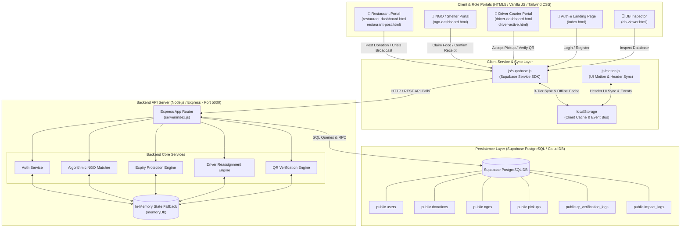
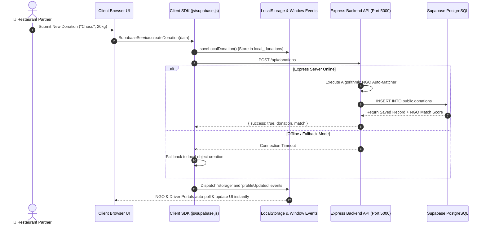
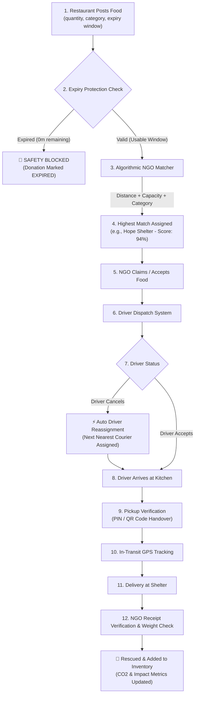
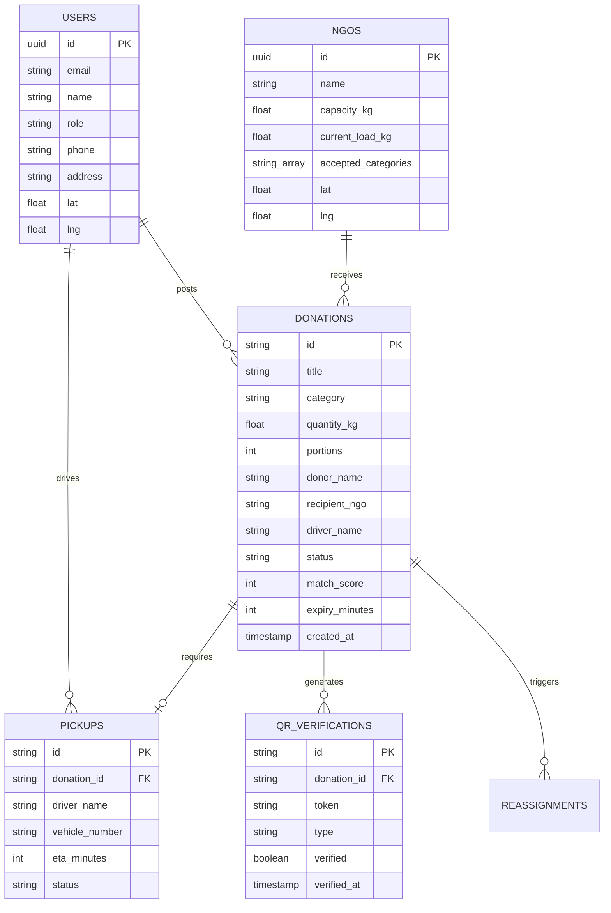

# 🏗️ Surplus-To-Shelter — System Architecture & Design Specification

---

## 1. High-Level System Architecture Diagram

---

## 2. 3-Tier Sync & Event Synchronization Architecture

---

## 3. End-to-End Food Rescue Lifecycle Workflow

---

## 4. Key Subsystem Components

| Component | Responsibility | Primary Files |
| :--- | :--- | :--- |
| **Auth & Profile Management** | User registration, role-based login (Restaurant/NGO/Driver), dynamic user profile name synchronization across headers without touching sidebars. | [`index.html`](file:///c:/Users/sachi/OneDrive/Desktop/Shelter/index.html), [`js/motion.js`](file:///c:/Users/sachi/OneDrive/Desktop/Shelter/js/motion.js) |
| **Donation Engine** | Posting surplus food, calculating remaining expiry timers, urgency badges, and managing donation lifecycles. | [`restaurant-post.html`](file:///c:/Users/sachi/OneDrive/Desktop/Shelter/restaurant-post.html), [`js/supabase.js`](file:///c:/Users/sachi/OneDrive/Desktop/Shelter/js/supabase.js) |
| **Algorithmic NGO Matcher** | Computes match scores (0-100%) evaluating distance (Haversine formula), shelter capacity buffer, accepted food categories, and expiry urgency. | [`server/index.js`](file:///c:/Users/sachi/OneDrive/Desktop/Shelter/server/index.js) (`/api/donations/auto-match`) |
| **NGO Intake & Logistics** | Dynamic rendering of available surplus queue, live tracking of incoming active delivery couriers, single-click food receipt verification, emergency crisis alert broadcast. | [`ngo-dashboard.html`](file:///c:/Users/sachi/OneDrive/Desktop/Shelter/ngo-dashboard.html) |
| **Driver Dispatch & Verification** | Courier queue dispatch, turn-by-turn route visualizer, automated fallback reassignment on cancellation, dual QR code scanning verification. | [`driver-dashboard.html`](file:///c:/Users/sachi/OneDrive/Desktop/Shelter/driver-dashboard.html), [`driver-active.html`](file:///c:/Users/sachi/OneDrive/Desktop/Shelter/driver-active.html) |
| **Database Inspector** | Live inspection of Supabase PostgreSQL tables and local memory stores. | [`db-viewer.html`](file:///c:/Users/sachi/OneDrive/Desktop/Shelter/db-viewer.html) |

---

## 5. Database Schema & Data Models

